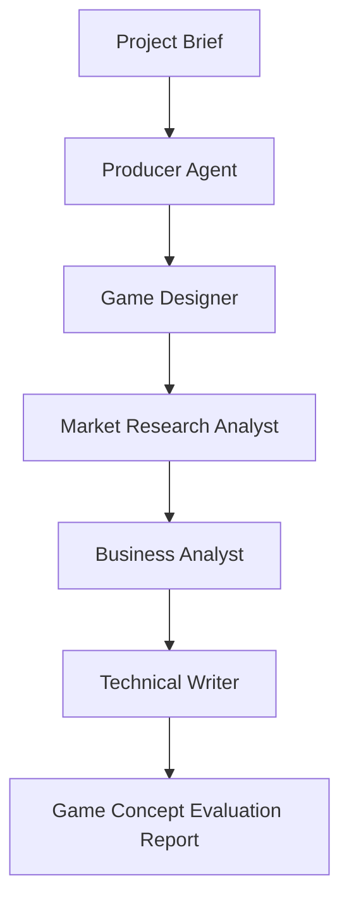

# IdeaForge

**AI-Driven Game Concept Generator**

IdeaForge is an experimental multi-agent AI pipeline designed to generate, analyze, and evaluate video game concepts based on creativity, market trends, commercial potential, and production feasibility.

Built with OpenCode, IdeaForge explores how agentic AI can automate creative and analytical workflows traditionally performed by specialized professionals within the video game industry.

## Objectives

- Generate original video game concepts.
- Identify emerging market trends and commercial opportunities.
- Analyze competing products and audience demand.
- Evaluate the commercial potential of game concepts.
- Generate structured reports to support production decisions.
- Explore multi-agent collaboration and agentic orchestration.

## Architecture

IdeaForge implements a multi-agent architecture in which each agent assumes a specialized role within a simulated game development organization.



## Agents

| Agent | Responsibility |
|---|---|
| Producer | Orchestrates the pipeline and delegates responsibilities. |
| Game Designer | Generates original game concepts and gameplay mechanics. |
| Market Research Analyst | Investigates market trends, competitors, and audience demand. |
| Business Analyst | Evaluates commercial potential and production feasibility. |
| Technical Writer | Consolidates findings into a structured executive report. |

## Project Structure

```text
IdeaForge/
├── .opencode/
│   └── agents/
│       ├── producer.md
│       ├── game-designer.md
│       ├── market-analyst.md
│       ├── business-analyst.md
│       └── technical-writer.md
├── output/
├── AGENTS.md
├── brief.md
├── opencode.json
└── README.md
```

## Technologies

- **OpenCode** — Agentic AI harness and orchestration.
- **Large Language Models (LLMs)** — Creative generation, reasoning, and analysis.
- **Markdown** — Agent definitions, instructions, and reporting.
- **JSON** — Structured data exchange between agents.
- **Web Research Tools** — Market intelligence and competitive analysis.

## Getting Started

### Prerequisites

- OpenCode installed and configured.
- Access to an LLM with tool-calling capabilities.
- Access to web research tools for market analysis.

### Configuration

Modify `brief.md` to define the project constraints, including:

- Target platform
- Production budget
- Team size
- Development timeline
- Target audience
- Business model

### Execution

From the project directory, execute:

```bash
opencode run --agent producer "Execute the game concept evaluation pipeline."
```

The producer agent coordinates the specialized agents throughout the pipeline.

## Generated Artifacts

| Artifact | Description |
|---|---|
| `concepts.json` | Generated game concepts. |
| `market-analysis.json` | Market research and competitive analysis. |
| `evaluation.json` | Commercial evaluation, scores, and rankings. |
| `report.md` | Final game concept evaluation report. |

## Experimental Scope

IdeaForge is a research and educational project exploring the application of agentic AI within video game production.

Rather than simply automating individual tasks, the project investigates how autonomous agents can assume specialized roles and responsibilities, collaborate, and contribute to a common production objective.

Generated market analyses and commercial recommendations require human validation before being used to make investment or production decisions.

## Future Development

- Parallel agent execution
- Automated concept refinement
- Historical market data integration
- Steam API integration
- Human-in-the-loop validation
- Automated concept art generation
- Financial forecasting
- Prototype generation